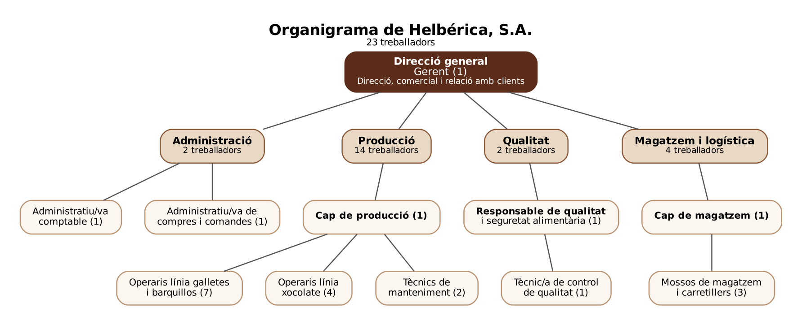

# 02 · Departaments i estructura organitzativa

## 1. Tipus d'estructura

Helbérica té una **estructura funcional i jeràrquica**: l'empresa es divideix en departaments segons la funció que fan (produir, controlar la qualitat, emmagatzemar, administrar) i tots depenen directament de la **Direcció general**.

És l'estructura més adequada per a una **petita empresa de 23 treballadors** perquè:

- Hi ha pocs nivells jeràrquics, de manera que les decisions es prenen ràpidament.
- Cada treballador sap clarament a qui ha de donar compte.
- Cada departament s'especialitza en la seua tasca.

El departament de **Qualitat depèn directament de la Direcció** i no de Producció. Així pot controlar el producte de manera independent, que és un requisit de la certificació de seguretat alimentària IFS.

## 2. Organigrama

## 3. Departaments, funcions i treballadors

### 3.1. Direcció general (1 treballador)

Dirigeix l'empresa i pren les decisions estratègiques.

- Planificar els objectius de l'empresa i coordinar tots els departaments.
- Negociar amb els clients (cadenes de supermercats) els preus, els volums i els terminis.
- Aprovar les inversions en maquinària i instal·lacions.
- Supervisar els resultats econòmics.

Com que és una empresa xicoteta amb pocs clients grans, la **funció comercial** la porta directament la Direcció.

### 3.2. Administració (2 treballadors)

Gestiona la part econòmica i documental de l'empresa.

- Portar la comptabilitat i la facturació.
- Gestionar les nòmines i la documentació del personal.
- Fer les compres de matèries primeres (farina, sucre, cacau...) i d'envasos.
- Registrar les comandes dels clients i comunicar-les a Producció i Magatzem.

### 3.3. Producció (14 treballadors)

És el departament més gran perquè és on es fabrica el producte.

- Fabricar galletes, barquillos farcits i tauletes de xocolate.
- Planificar la producció segons les comandes rebudes.
- Controlar el funcionament de les línies de producció i l'envasament.
- Fer el manteniment de la maquinària perquè no s'aturen les línies.

### 3.4. Qualitat (2 treballadors)

Garanteix que el producte és segur i compleix els requisits dels clients.

- Controlar les matèries primeres quan arriben.
- Fer anàlisis i controls del producte durant la fabricació i al final.
- Mantenir el sistema de seguretat alimentària i la certificació IFS.
- Gestionar la traçabilitat dels lots i les possibles incidències o reclamacions.

### 3.5. Magatzem i logística (4 treballadors)

Gestiona l'entrada i l'eixida de mercaderia.

- Rebre i col·locar les matèries primeres i els envasos.
- Emmagatzemar el producte acabat.
- Preparar les comandes i carregar els camions.
- Controlar l'inventari (estocs).

### 3.6. Resum de treballadors

| Departament | Treballadors |
|-------------|:------------:|
| Direcció general | 1 |
| Administració | 2 |
| Producció | 14 |
| Qualitat | 2 |
| Magatzem i logística | 4 |
| **Total** | **23** |

## 4. Llocs de treball i funcions principals

| Lloc de treball | Departament | Nombre | Funcions principals |
|-----------------|-------------|:------:|---------------------|
| Gerent | Direcció general | 1 | Dirigir l'empresa, relació amb els clients, decisions estratègiques |
| Administratiu/va comptable | Administració | 1 | Comptabilitat, facturació i nòmines |
| Administratiu/va de compres i comandes | Administració | 1 | Compres a proveïdors i gestió de les comandes dels clients |
| Cap de producció | Producció | 1 | Planificar la producció i coordinar els operaris i el manteniment |
| Operari/ària de línia de galletes i barquillos | Producció | 7 | Fer funcionar la línia, controlar el procés i l'envasament |
| Operari/ària de línia de xocolate | Producció | 4 | Fer funcionar la línia de tauletes i l'envasament |
| Tècnic/a de manteniment | Producció | 2 | Manteniment preventiu i reparació de la maquinària |
| Responsable de qualitat i seguretat alimentària | Qualitat | 1 | Sistema IFS, auditories, traçabilitat i incidències |
| Tècnic/a de control de qualitat | Qualitat | 1 | Controls i anàlisis de matèries primeres i producte |
| Cap de magatzem | Magatzem i logística | 1 | Organitzar el magatzem, l'inventari i les expedicions |
| Mosso de magatzem / carretiller | Magatzem i logística | 3 | Càrrega i descàrrega, ubicació de mercaderia i preparació de comandes |
| **Total** | | **23** | |

## 5. Valoració dels recursos humans

- **Producció concentra el 61 % de la plantilla** (14 de 23), cosa normal en una empresa industrial on la major part de la feina és fabricar.
- Els departaments de suport (Administració, Qualitat i Magatzem) són **xicotets però suficients**, perquè l'empresa té pocs clients però amb comandes de gran volum.
- Dos tècnics de manteniment permeten **reduir les parades** de les línies, cosa important per a complir els terminis de les cadenes de supermercats.
- No calen departaments propis de màrqueting ni de vendes, perquè l'empresa fabrica **marca blanca** i no ha de promocionar una marca pròpia.
